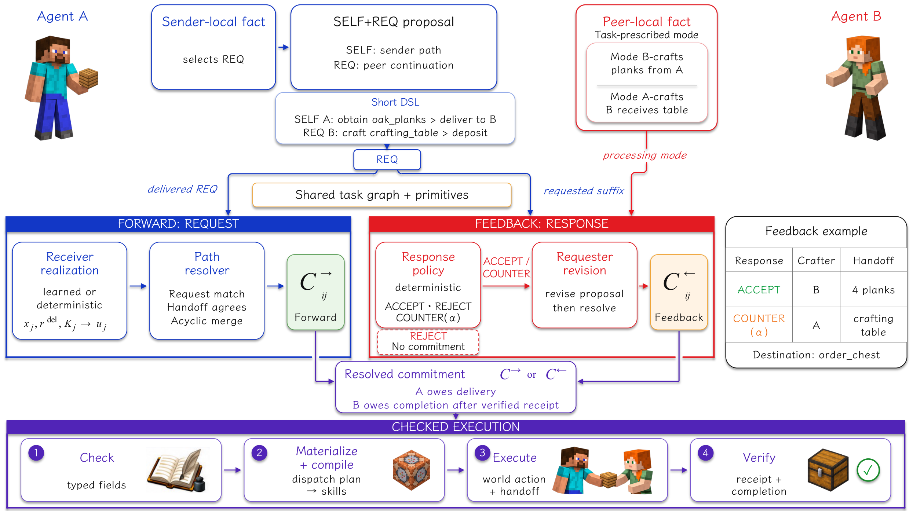
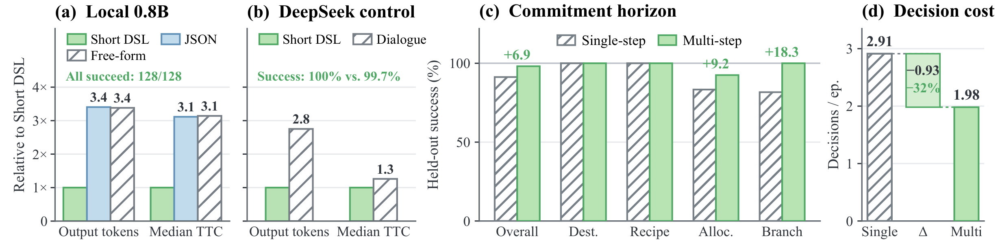
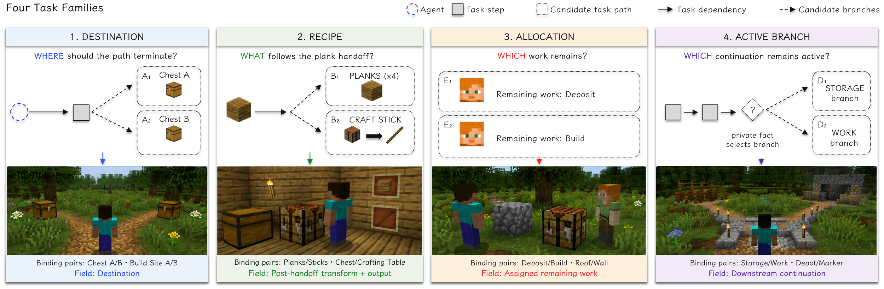

<div align="center">

# GenCoord

### Executable Commitments for Embodied LLM Agents under Private Information

**Make the division of work the message.**

<p>
  <a href="https://arxiv.org/abs/2608.22055"><b>Paper</b></a>
  &nbsp;·&nbsp;
  <a href="docs/GenCoord_preprint.pdf"><b>PDF</b></a>
  &nbsp;·&nbsp;
  <a href="paper/"><b>LaTeX</b></a>
  &nbsp;·&nbsp;
  <a href="data/"><b>Data</b></a>
  &nbsp;·&nbsp;
  <a href="#citation"><b>Citation</b></a>
</p>

<p>
  <a href="https://arxiv.org/abs/2608.22055"></a>
  <a href="docs/GenCoord_preprint.pdf"></a>
  <a href="data/"></a>
  
</p>

**Peng He**<sup>1,&#42;</sup>, **Junning Zhu**<sup>2,&#42;</sup>, **Haohan Yuan**<sup>3</sup>, **Jianpeng Liang**<sup>4</sup>  
<sup>&#42; Equal contribution</sup>

<table width="100%">
  <tr height="92">
    <td width="25%" align="center" valign="middle">
      <a href="https://www.tsinghua.edu.cn/">
        
      </a>
    </td>
    <td width="25%" align="center" valign="middle">
      <a href="https://www.bnbu.edu.cn/">
        
      </a>
    </td>
    <td width="25%" align="center" valign="middle">
      <a href="https://www.charlotte.edu/">
        
      </a>
    </td>
    <td width="25%" align="center" valign="middle">
      <a href="https://ucsd.edu/">
        
      </a>
    </td>
  </tr>
  <tr>
    <td align="center" valign="top"><sup>1</sup> <b>Tsinghua University</b><br></td>
    <td align="center" valign="top"><sup>2</sup> <b>Beijing Normal-Hong Kong Baptist University</b><br></td>
    <td align="center" valign="top"><sup>3</sup> <b>University of North Carolina at Charlotte</b><br></td>
    <td align="center" valign="top"><sup>4</sup> <b>University of California San Diego</b><br></td>
  </tr>
</table>

</div>

<p align="center">
  
</p>
<p align="center">
  <sub>A proposal pairs the sender's own work with the continuation it asks of its partner. Compatible proposals become commitments: the sender owes delivery, and the receiver owes its work once receipt is verified.</sub>
</p>

Embodied LLM agents that each hold private task information must agree on who does what. In dialogue, models spend inference writing and reading messages before anyone acts. **GenCoord sends the division of work itself:** each proposal names the sender's skill path and the partner's continuation, so the receiver can check and execute it directly, and the model's job reduces to choosing and revising the work.

## How it works

| Propose | Commit | Execute and check |
| --- | --- | --- |
| Each agent writes a `SELF+REQ` proposal in **Short DSL**: its own skill path and the continuation it requests from its partner. | When the paths agree on the handoff and their dependencies are acyclic, they resolve into a conditional commitment. Structured feedback lets the requester revise the actor and handoff. | Skills run in Minecraft. Inventory and world readback check **fulfillment** of the commitment separately from **success on the original task**. |

```text
SELF resource.obtain(q=4,item=oak_planks)
  > resource.deliver(q=4,item=oak_planks,to=agent_b)
REQ  agent_b craft.item(q=1,input=oak_planks,item=crafting_table)
  > resource.deliver(q=1,item=crafting_table,dst=order_chest)
```

Because a complete request already specifies the receiver's work, a deterministic receiver can realize it without another model call. Models choose; skills realize.

## Results

| Setting | Finding |
| --- | --- |
| **Local 0.8B agents** | Same task success as controlled free-form communication (128/128), with **68.2%** lower median commitment time and **92.8%** less peer traffic. |
| **Same-field JSON** | Output length and delay close to free-form: the amount generated matters even when messages are structured. |
| **Hosted DeepSeek** | Both protocols complete nearly all tasks (768/768 vs. 766/768); dialogue generates **2.8×** the output tokens, and Short DSL cuts mean commitment time by **30.4%**. |
| **Multistep commitments** | Held-out-template success rises from **91.3%** to **98.1%**, while online decisions fall from **2.91** to **1.98** per episode. |

<p align="center">
  
</p>

<details>
<summary><b>Task families</b></summary>
<br>
<p align="center">
  
</p>
Eight templates in four families vary what a private fact changes: the destination, the post-handoff recipe, the assigned remaining work, or the downstream continuation.
</details>

## Repository

```text
paper/    preprint source: main text and appendix
data/     appendix source data (guide: data/README.md)
docs/     compiled preprint
assets/   README figures, affiliation marks
```

Build the preprint with a recent TeX Live (pdfLaTeX and latexmk):

```bash
make            # writes build/GenCoord_preprint.pdf
```

## Citation

```bibtex
@misc{he2026gencoord,
  title         = {GenCoord: Executable Commitments for Embodied LLM Agents under Private Information},
  author        = {Peng He and Junning Zhu and Haohan Yuan and Jianpeng Liang},
  year          = {2026},
  eprint        = {2608.22055},
  archivePrefix = {arXiv},
  primaryClass  = {cs.AI},
  url           = {https://arxiv.org/abs/2608.22055}
}
```

## License

The `Makefile` and `data/cost_contrasts/cost_intervals.py` are MIT-licensed. The manuscript, figures, data, institutional marks, and bundled venue files follow the terms in [`LICENSE`](LICENSE) and [`THIRD_PARTY_NOTICES.md`](THIRD_PARTY_NOTICES.md).
